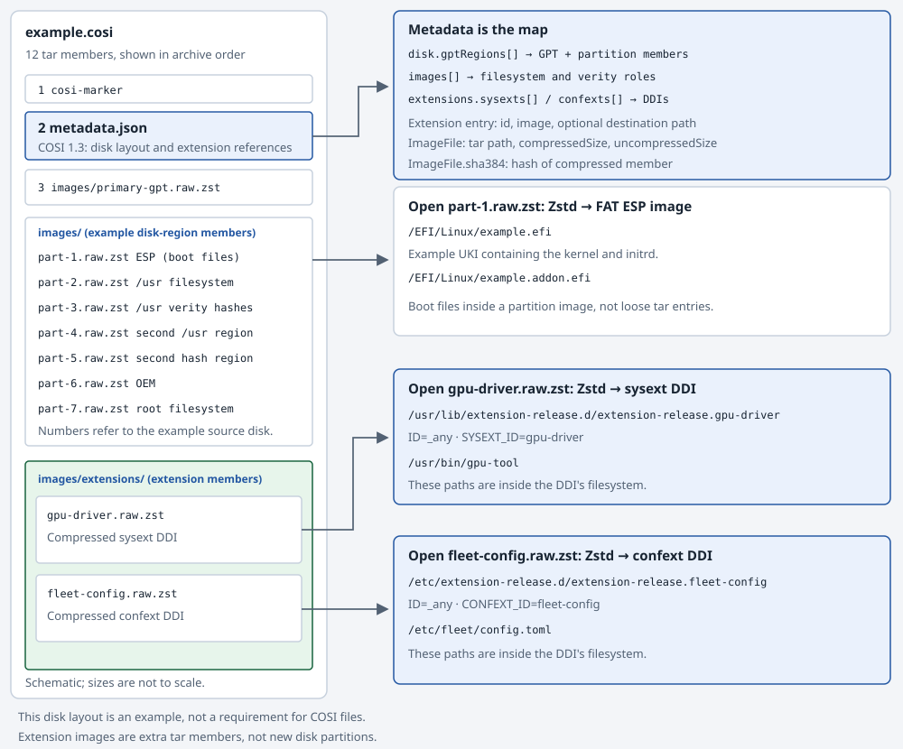

# 0789 COSI Extension Images

- Date: 2026-09-08
- RFC PR: [microsoft/trident#789](https://github.com/microsoft/trident/pull/789)

## Summary

Carry sysext and confext images as compressed members of a COSI tar. An optional
`extensions` section lists each [`ImageFile`](../../Reference/Composable-OS-Image.md#imagefile-object)
and, when placement is prescribed, its destination `path`. Trident can deploy
extensions with the OS image instead of fetching them separately.

## Motivation and Goals

Host Configuration extensions need separate hosting, downloads and updates.
Bundling gives OS-coupled extensions the COSI's integrity chain and the same
A/B rollout, reboot and rollback as the OS. Host Configuration extensions remain
available for content released independently.

## Scope

### Requirements

- COSI revision 1.3 adds optional `extensions.sysexts` and
  `extensions.confexts` arrays, each entry `{ id, image, path? }`.
- Clean Install and A/B Update deploy the effective set from COSI and Host
  Configuration; collisions fail.

### Out of Scope

- Changes to the Host Configuration API, DDIs, SELinux support or signing.
- The Image Customizer API and implementation for producing these COSIs;
  separate work.
- Trident placement, activation and Host Configuration persistence; covered by
  [RFC 0838](https://github.com/microsoft/trident/pull/838).
- Partition-less COSI files.
- Extension-only Runtime Updates. Any change to a COSI, including only its
  extensions, requires an A/B update.
- Bundled extensions under [disk streaming](../../Explanation/Disk-Streaming.md);
  refuse them until streaming can enable the merge units.

### Exit Criteria

Publish the 1.3 schema and samples. Deploy sysexts and confexts on Clean Install
and A/B Update with slot-correct rollback. Reject collisions and unsupported
disk streaming.

## Dependencies

A separately defined [Image Customizer](https://github.com/microsoft/azure-linux-image-tools)
API must produce COSIs with embedded extensions. Deployment depends on the
separate placement and persistence work.

## Implementation

### Tar Layout

Payloads are ZSTD-compressed DDIs under `images/extensions/`; this preserves
`ImageFile.path`'s `^images/.+` constraint. The primary GPT image must
immediately follow `metadata.json`. Write extension members after the
disk-region images and include their window sizes in `compression.maxWindowLog`.
Older readers ignore the additional tar members.



### Metadata Schema

The two arrays mirror Host Configuration and determine the kind; each entry
contains an `id`, an `image` and optional `path`. This is the proposed addition to
the [1.2 schema](../../Reference/Composable-OS-Image/cosi-metadata-v1.2.schema.json):

```json
{
  "properties": {
    "extensions": { "$ref": "#/$defs/Extensions" }
  },
  "$defs": {
    "Extensions": {
      "type": "object",
      "properties": {
        "sysexts": { "type": "array", "items": { "$ref": "#/$defs/ExtensionImage" } },
        "confexts": { "type": "array", "items": { "$ref": "#/$defs/ExtensionImage" } }
      }
    },
    "ExtensionImage": {
      "type": "object",
      "required": ["id", "image"],
      "properties": {
        "id": { "type": "string", "minLength": 1 },
        "image": { "$ref": "#/$defs/ImageFile" },
        "path": { "type": "string", "pattern": "^/.+\\.raw$" }
      }
    }
  }
}
```

Example (`extensions` fragment of `metadata.json`):

```json
{
  "sysexts": [{
    "id": "gpu-driver",
    "image": {
      "path": "images/extensions/gpu-driver.raw.zst",
      "compressedSize": 41943040,
      "uncompressedSize": 134217728,
      "sha384": "3a1f9c0d4e5b6a7c8d9e0f1a2b3c4d5e6f708192a3b4c5d6e7f8091a2b3c4d5e6f708192a3b4c5d6e7f8091a2b3c4d5e"
    }
  }],
  "confexts": [{
    "id": "fleet-config",
    "image": {
      "path": "images/extensions/fleet-config.raw.zst",
      "compressedSize": 262144,
      "uncompressedSize": 1048576,
      "sha384": "c3d4e5f60718293a4b5c6d7e8f90a1b2c3d4e5f60718293a4b5c6d7e8f90a1b2c3d4e5f60718293a4b5c6d7e8f90a1b2"
    },
    "path": "/var/lib/confexts/fleet-config.raw"
  }]
}
```

`id` is Trident's stable identity for the extension, not the COSI root `id`
or the OS's `ID=`. It must match `SYSEXT_ID=` or `CONFEXT_ID=` in the DDI's
`extension-release` file and be unique within its array. Trident already
requires these fields in the DDI; metadata makes `(kind, id)` available
without opening it.

`ImageFile` gives the tar path, compressed and uncompressed sizes, and
SHA-384 of the compressed member. The Host Configuration's `Extension.sha384`
instead hashes the raw DDI; the two hashes are not interchangeable.

`path` is optional so Trident can own placement. Today omission defaults to
`/var/lib/extensions/{name}.raw` or `/var/lib/confexts/{name}.raw`; an
explicit path must use a supported directory and match the
`extension-release.{name}` suffix. Omitting it does not opt into the
`scope: slotted` policy proposed in
[RFC 0838](https://github.com/microsoft/trident/pull/838).

No other field is needed: the array identifies the kind, the tar replaces
`url`, and the DDI supplies name and compatibility. The filename affects
systemd's merge order, but is not Trident's update identity.

### Versioning

COSI revision 1.3 adds the optional section; older COSIs behave unchanged.
Existing Trident accepts any `1.x` metadata and ignores unknown fields, so it
silently skips bundled extensions. That omission does not self-heal after a
Trident upgrade because the image is already recorded as deployed. Require a
1.3-aware reader, warn on unknown minor versions in new readers, and use a
[health check](../../Reference/Host-Configuration/API-Reference/Health.md) for
required extensions when reader versions cannot be controlled.

### Reader Contract

On Clean Install and A/B Update, Trident deploys COSI extensions with the OS.
It merges them with operator-provided Host Configuration extensions and rejects
conflicting IDs or resolved destinations; neither source silently overrides
the other. A/B placement must follow the target slot so rollback restores the
previous extension set. Enforcing SELinux remains unsupported.

### Validation

Reject duplicate `(kind, id)` values, reused tar paths, invalid explicit
destinations and missing members. Verify `ImageFile` sizes and the SHA-384 of
the compressed member, then check that the DDI's `SYSEXT_ID` or `CONFEXT_ID`
equals the declared `id` and its `extension-release.{name}` matches the
installed filename. These failures must be reported, not silently skipped.

## Testing and Metrics

- Schema samples for both kinds, optional `path` and invalid entries.
- Reader tests for member integrity and metadata/DDI ID agreement. Deployment
  and rollback tests belong with downstream implementation.

## Counter-Arguments

### Drawbacks

Bundling still ties distribution to a new COSI; even extension-only changes
require an A/B update and reboot. It increases image size and gives hosts no
per-extension opt-out.

### Alternatives

Embedding `.raw` files in a partition image hides them from COSI metadata,
fails when the destination is a separately created filesystem, and changes
verity hashes. A separate Host Configuration URL remains preferable for
independent release cycles.

Flatcar's sysext-bakery pairs pre-built DDIs with
[`systemd-sysupdate`](https://www.freedesktop.org/software/systemd/man/latest/systemd-sysupdate.html),
hosting artefacts over HTTP with a `SHA256SUMS` manifest. Like `os.sysexts`, it
optimises for extensions that move independently of the OS, though without an
OCI transport. Bundling optimises for extensions that must move with it.

## Future Work

Extension-only Runtime Updates and explicit operator overrides of bundled
extensions need separate designs.
