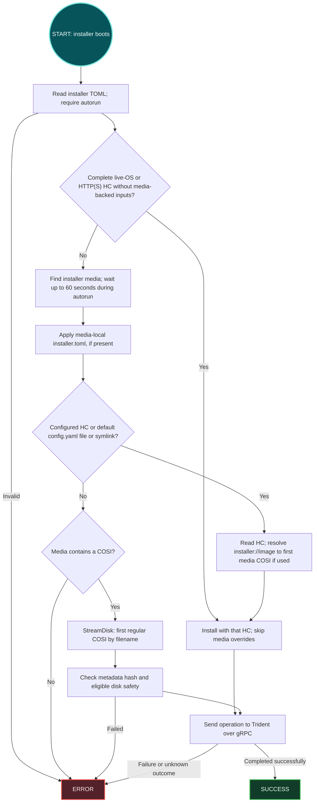
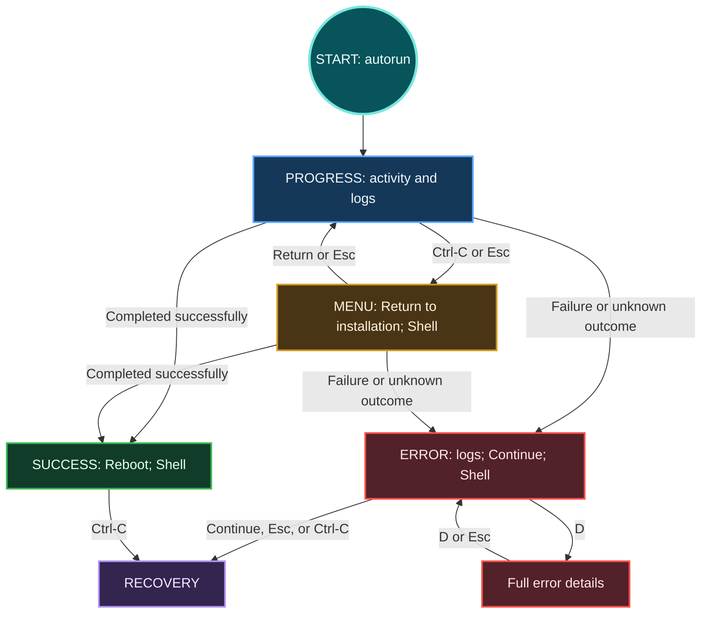
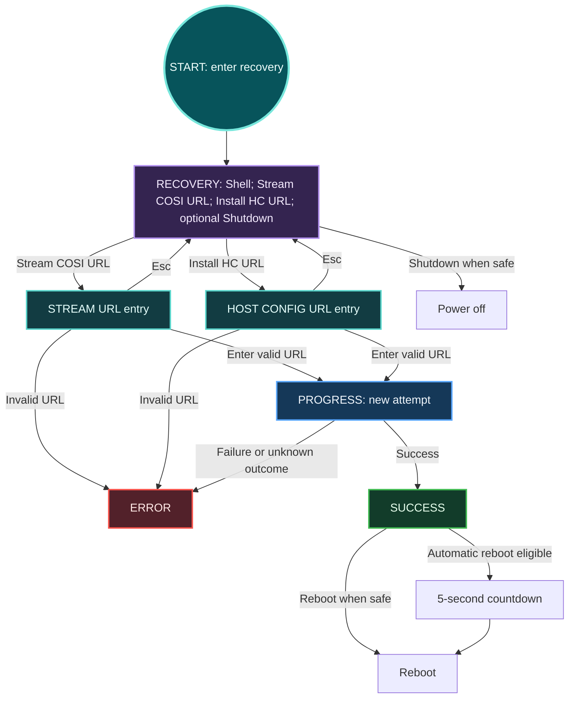

# Trident Installer

Install the optional `trident-installer` RPM on a full-OS installer ISO and add
`trident.installer=1` to the **ISO boot kernel command line**. The packaged
systemd service starts only when that argument is present; installing the RPM
alone does not start an installation. See
[Installer Configuration](./Installer-Configuration.md#building-an-installer-iso)
for an ISO recipe.

A [Host Configuration](./Host-Configuration/Host-Configuration.md) (HC) is YAML
describing the OS image, disk layout, and settings for Trident's **Install**
operation. A [Composable OS Image](./Composable-OS-Image.md) (COSI) contains
the image data that **StreamDisk** writes to a disk. **Autorun** selects one
of these operations from the available sources and starts without an initial
confirmation or source picker. The terminal UI shows progress and offers
recovery after a failure or interruption. `mode = "interactive"` is reserved
and currently rejected.

## Choosing the installation source

`installer://image` is a reserved HC image URL meaning "use the first COSI
found on installer media," not a filename. Media is also needed for a
media-relative HC, a dangling HC symlink into the media, or another file-backed
HC input on the media (such as an additional file, script, extension, or
recovery key). A self-contained HC takes
precedence over media settings even if the media is already present. An invalid
HC fails; it does not fall back to StreamDisk.

StreamDisk preflight reads the COSI's required disk size and metadata hash. It
refuses a mounted or read-only disk that Trident could select as the smallest
one that fits, then passes the hash to Trident so its fetch uses the checked
metadata. See [Installer Configuration](./Installer-Configuration.md) for
accepted paths, filesystem labels, and overrides.

:::warning Reinstall on every installer boot

Autorun does not ask for confirmation or check whether the target OS is already
installed. Remove or deprioritize the installer media after installation;
leaving it first in boot order can reimage the machine on every boot.

:::

## Screens

The same screen has the same color in both diagrams: blue **PROGRESS**, amber
**MENU**, red **ERROR**, purple **RECOVERY**, and green **SUCCESS**. Teal circles
mark entry points; teal rectangles are URL-entry screens.

| Action | Behavior |
| --- | --- |
| Arrows, Tab, number keys, Enter | Select and activate an action. `V` changes only the display log filter; Page Up/Down scrolls logs or error details. |
| Ctrl-C / Esc | On PROGRESS, open MENU without stopping work; MENU's Esc or Return returns to PROGRESS. On ERROR, Esc or Continue opens RECOVERY; Esc first closes full details if open. On a URL-entry screen, Esc returns to RECOVERY. On SUCCESS, Ctrl-C opens RECOVERY. |
| `D` on ERROR | Toggle between the log panel and full error details. |
| Shell or `S` | Opens a root recovery shell from PROGRESS, MENU, ERROR, RECOVERY, or SUCCESS. Servicing continues and automatic reboot waits while the shell owns the terminal; `exit` returns to the latest screen. A nonzero shell exit is only a warning. |
| Stream COSI URL / Install HC URL | Recovery accepts HTTP(S) URLs without embedded username or password. A new attempt reloads installer TOML. Explicit StreamDisk recovery skips local media; recovery HC checks it once without waiting. |
| Reboot / Shutdown | A running worker or uncertain outcome blocks power actions. Shutdown is not offered while the outcome is uncertain; a later attempt first checks Trident's servicing state before another write. |
| Automatic reboot | Starts five seconds after success **only** when enabled, work was performed, and Trident says a reboot is required. |

With `--system-console`, the installer uses tty1 for the UI and mirrors logs
to active serial consoles; serial consoles do not receive a TUI. `--plain`
uses line-oriented output instead of the full-screen display. Without an
interactive terminal, autorun still runs, but a failure exits with an error
instead of opening recovery. All received events are retained in the private
`/var/log/trident-installer.log`, regardless of display or serial filtering.
