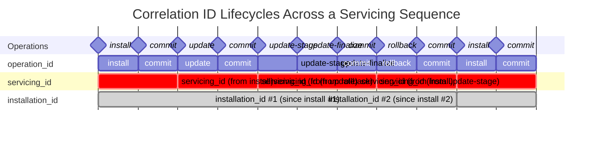

# Telemetry

Trident records enriched metrics and span timings in
`/var/log/trident-metrics.jsonl`, regardless of whether remote telemetry is
enabled. When journald is available, a separate tracing layer records events
and spans under the `trident-tracing` syslog identifier.

Both outputs include the available correlation IDs, command and source.
Journald uses structured fields `T_OPERATION_ID`, `T_INSTALLATION_ID`,
`T_SERVICING_ID`, `T_COMMAND` and `T_SOURCE`. IDs are resolved when an event
is emitted, so later events can include identities loaded after startup.
`command_start` and `trident_start` omit installation and servicing IDs in
both outputs. Events outside an operation do not invent an operation ID.

Other host metadata described below is added to JSONL records, not
automatically to journald entries. Retrieve the journald output with:

``` bash
journalctl -t trident-tracing
journalctl -t trident-tracing T_OPERATION_ID=<operation-id> -o json
```

The local metrics file follows process lifetime, not a single servicing
operation. Commands that own the file's lifecycle truncate it at startup;
other commands, including `diagnose` and the gRPC client, append instead.
A daemon can accumulate records from multiple gRPC requests in one file.
`diagnose` packages the existing metrics file.

The local metrics file can be found here: `/var/log/trident-metrics.jsonl`.
Servicing paths later copy the current file beside the configured
datastore as `trident-metrics-<SERVICING_STATE>-<TIMESTAMP>.jsonl`
(under `/var/lib/trident` when using the default datastore path).

On top of these local copies, Trident can optionally send this same
best-effort stream of tracing data to Azure Monitor / Application
Insights. See [Agent Configuration](./Agent-Configuration.md) for how to
configure it.

Telemetry defaults to **enabled** (`OptIn`) when a usable connection
string was compiled into the binary. To disable it, add a line to
`/etc/trident/trident.conf`:

``` conf
Telemetry=OptOut
```

Alternatively, install `trident-telemetry-optout` to configure the opt-out
while preserving other agent settings.

## Host Metadata

Every event sent also includes as much of the following host metadata as
is available at the time, so operators should be aware this leaves the
host along with the metrics/spans themselves:

- `os_release`: the `VERSION` field from `/etc/os-release`.
- `kernel_version`: the running kernel release (`uname -r`).
- `total_cpu`: the number of CPUs.
- `total_memory_gib`: total memory, in GiB.
- `vm`: whether the host appears to be a virtual machine, detected from DMI
  vendor/product strings (`/sys/class/dmi/id/sys_vendor`,
  `/sys/class/dmi/id/product_name`). Best-effort: reports `false` if the
  DMI files are unreadable or the hypervisor is not one of the recognized
  vendors, not necessarily "definitely bare metal".
- `arch`: the CPU architecture Trident is running on, as reported by
  `SystemArchitecture` (e.g. `amd64`, `arm64` -- not the kernel's own
  `x86_64`/`aarch64` naming).
- `acl`: whether the host is running Azure Container Linux (ACL), as a
  string -- `"true"`, `"false"`, or `"unknown"` if detection itself
  failed. Best-effort, like `vm` above: an `"unknown"` detection failure
  is kept distinct from a known negative, rather than folded into
  `"false"`.
- `trident_version`: the running Trident version.
- `installation_id`: an ID that lets separate events be correlated back to
  the same host installation over time, including its multiboot
  environments. It is absent until an installation identity is loaded or
  created; an `operation_id` is not a substitute.
  `grpc-client` does not attach datastore-backed IDs, so its events omit
  this field. The daemon handling the request attaches its own IDs.
- `servicing_id`: an ID that lets events emitted across a whole servicing
  operation (an install, update, or manual rollback) be correlated with
  each other.
- `operation_id`: an ID that lets events emitted during the same command
  invocation be correlated with each other.
- `command`: which command produced the event (e.g. `install`, `update`,
  `update_stage`, `update_finalize`, `commit`, `rollback`, `rebuild_raid`).
- `source`: which of Trident's entry points produced the event -- `cli` (a
  command run directly, without a daemon), `daemon` (a command the daemon
  executed for a gRPC request), or `grpc-client` (the CLI acting as a
  client, relaying a command to a running daemon). All three are wired up
  to produce `operation_id`/`command`/`source`; `grpc-client` does not
  attach persisted `installation_id`/`servicing_id` (see above).

`command_start` and `trident_start` always omit `installation_id` and
`servicing_id`, even when those IDs are already cached. These startup
events retain `operation_id`, `command`, `source`, and host metadata.
Later events include the persistent IDs when available.

## Correlation ID Lifecycle

The three correlation-style fields above have deliberately different
lifetimes -- some outlive many servicing operations, some are recreated on
every reinstall, and some exist only for a single command invocation. The
diagram below shows how each behaves across a representative sequence of
operations: `install`, `commit`, `update`, `commit`, `update-stage`,
`update-finalize`, `commit`, `rollback`, `commit`, `install`, `commit`.



Reading the diagram by row, from most to least stable:

- **`installation_id`**: normally created once at the first `install`
  and shared by its multiboot environments. A multiboot install inherits
  the running OS's installation ID, persisting it in the staging datastore
  and then copying it into the target datastore during finalize. A reused
  staging datastore adopts the source ID without resetting servicing state.
  An independent reinstall with a new datastore creates a new ID (the
  second `install`, day 10, in the diagram). The CIH update-bootstrap path
  and migrating a legacy (pre-`installation_id`) datastore can also create
  an ID outside of `install`. Existing multiboot partitions are not scanned
  to reconcile previously divergent IDs.
- **`servicing_id`**: correlates every event in one servicing episode
  (across separate stage/finalize invocations and any later `commit`)
  back to whichever invocation actually staged it. Regenerated by every
  invocation that stages something new (`install`, `update`,
  `update-stage`, `rollback`) -- note `update-finalize` does *not*
  regenerate it, since finalize-only invocations only read the value back.
- **`operation_id`**: the shortest-lived of the three, minted fresh for
  every single command invocation and never reused.

## Command Errors

If a *servicing* command (`install`, `update`, `commit`, `rollback`,
`rebuild_raid`, `stream_disk`, and their gRPC/`grpc-client` equivalents)
fails (except for the admission-control rejections below), a
`command_error` event is also sent (tagged with the same
`operation_id`/`command` as above), breaking the failure down into:

- `kind`: the top-level error category (e.g. `internal`, `invalid-input`,
  `servicing`, `initialization`).
- `subkind`: the specific error within that category (e.g.
  `check-root-privileges`), when one applies.
- `location`: the `file:line` in Trident's source where the error was
  originally raised.

A `grpc-client` invocation only fires its own `command_error` when the
daemon it talked to never actually responded (a transport-level failure:
the daemon's socket wasn't found, the connection was refused, or it
dropped mid-call). For daemon-reported command failures, the daemon's own
`command_error` already has full `kind`/`subkind`/`location` fidelity, so
`grpc-client` stays silent rather than reporting the same failure again
under a generic classification.

Admission-control rejections for a busy daemon (connection or servicing
lock contention) or an unprovisioned host intentionally emit no
`command_error` from either the daemon or the client. Consequently,
`command_error` is not a count of every failed invocation.

## Delivery

Telemetry delivery is always best-effort and never affects servicing
outcomes, but failures are not all logged at the same level: a failure to
serialize an event, or to enqueue it because the background uploader has
already shut down, is logged at trace level, while a failure to actually
deliver an event (e.g. no network connectivity, or a non-2xx response from
Application Insights) is logged at error level, so operators can find
remote-delivery problems in normal logs.
